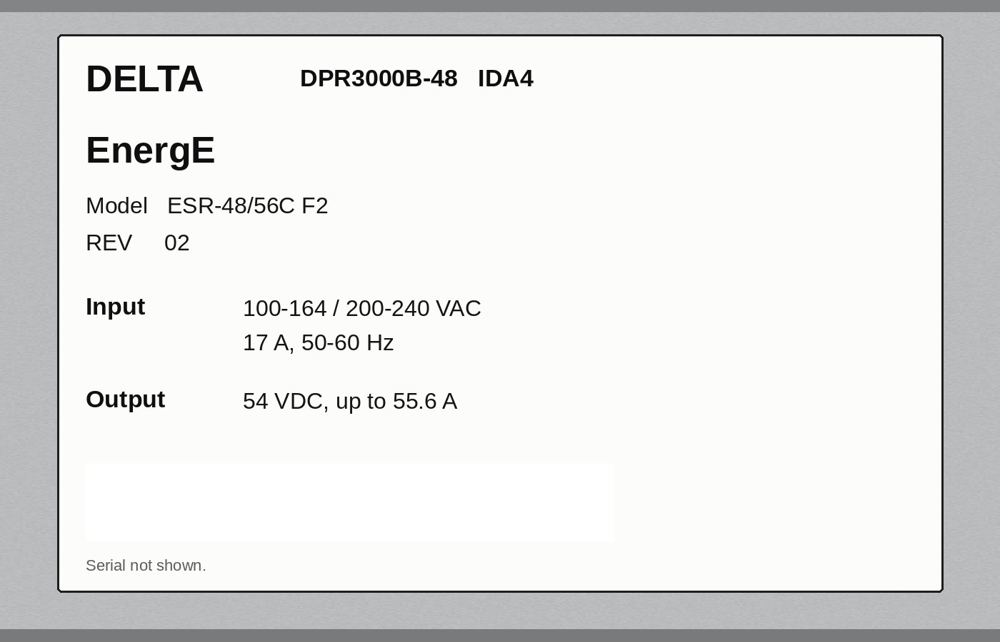

# MR450w 48V PDU power supply replacement, Condor to Delta (GE 5745311 / Delta DPR3000B-48)

> DRAFT – AMT field notes compiled from GE service documentation. Not a GE document and not GE-certified.
> Follow the current GE procedure for your system and software. **[Inferred]** = not stated in a GE source.

## Part
- **GE FRU 5745311**, "Delta 48V 2500W Power Supply". Fits PS1 and PS2 of the TEAL XGD PDU (GE 5140621) in the PGR cabinet. [DOC1805613 Rev3 Table 3, item 4; GE Service Shop 5745311-R]
- **Unit on hand:** Delta DPR3000B-48 IDA4 "EnergE", Model ESR-48/56C F2 Rev 02.
  - Input: 100–164 / 200–240 VAC, 17 A, 50–60 Hz.
  - Output: 54 VDC, up to 55.6 A.
  - Rear connector: FCI PwrBlade 51939.
  - Ships with a yellow "CM-2 / 48V output for GE" label and a small adapter PCB.
  - GE shipped this unit as the PS1 replacement with the output already set before shipping; no output adjustment is needed. GE identifies a Delta supply by its **"EnergE" label** [5690015-2EN step 1; DOC1805616 App. A p.57].
- **Brackets:**
  - 5140621-10: the original Delta bracket, with a harness connector on the back of each supply.
  - 5343114-10: the blind-mate bracket. The supplies plug straight into a rear connector.
- **Superseded part:** Condor 48V 1000W, GE 5140621-4.

## Sources
1. GE **Optima MR450w GEM service manual 5690015-2EN Rev 5**, topic "Replacing the 48V power supply" (id_2022137, v1.13, Mar 2023). [Open the 450w manual page](https://raw.githack.com/mikejackson-stack/AMT-GE-Manuals/main/Optima%20450W%20GEM/root/t_ReplacingThe48VPowerSupply_DV.html). **This is the 450w procedure.**
2. GE SIGNA PET/MR 5490579-3 Rev 12, the same topic (v1.14, Dec 2024). Location: AMT-GE-Manuals `Signa PET_MRI/root/t_ReplacingThe48VPowerSupply_DV.html`.
3. DOC1805613 Rev 3, "TEAL PDU Module (5140621) in XGD Cabinet": §3.1 LOTO, Table 3, §4.2.14 troubleshooting, Appendix A. The revision history says this appendix absorbed Service Note **DOC2175961** ("48V PDU Power Supply Replacement, Condor to Delta").
4. DOC1805616 Rev 3, "TEAL PDU Module in XGD2 Cabinet": **Appendix A, "GE FIELD NOTIFICATION: Instructions to replace Condor 48V PS Assy. with Delta 48V PS assembly"**, pp. 56–75.
5. TEAL TSB 102109-1, PS mounting screws.
6. Delta DPR3000B fact sheet (web).

## Before you start
- **Confirm the failed supply** [DOC1805613 §4.2.14 / App. A]:
  - A supply has failed if its green OK LED is off with power applied and the PDU not in ESTOP, or if the LED is lit but there is no 48 V out.
  - With CB9 on, J4 A1–A2 on the PTC board should read +48 VDC.
  - LED states [DOC1805616 p.64]: OK green = operating; off = shutdown; blinking = standby. NL yellow = output current under 5% of nominal.
- **Error codes pointing here:**
  - 2268225 EM_PDU_INT_FAIL: 48V under- or overvoltage, PS1 degraded.
  - 2267825: E-stop, possibly a low 48V supply.
  - 2267941: AUX 48V fault.
- **Condor or Delta now fitted?** Check the maintenance sticker 5661793 on the front of the PDU, or look through the PDU vent holes with a flashlight for the "EnergE" label [5690015-2EN].
  - **Condor fitted:** replace **both** PS1 and PS2 with two 5745311 supplies plus a Delta bracket. This is the first-time conversion.
  - **Delta fitted:** replace only the failed supply.
- **Tools:** nonmagnetic titanium tool kit 5112581 or 5113258, maintenance sticker 5661793, masking tape and marker.

## Procedure (summary; per 5690015-2EN)
1. **Lock out the PDU.**
   - DOC1805613 §3.1.1: shut down the host. Turn off the blower and pumps at the PLC keypad (^+F1/F2/F3). Press System Off on the MDP and turn the main input switch off.
   - Put the magnet monitor in Service mode.
   - Building power is disconnected (customer electrician), then apply LOTO.
   - Verify less than 1 V phase-to-ground and phase-to-phase at the MDP test points.
2. **Open the PDU.**
   - Remove the 4 × 6-32 x 3/8 screws on the circuit-breaker guard, then the 10-32 x 1/2 front-panel screws. Lower the panel away from the unit without damaging the leak-sensor strip.
   - Disconnect SW1 and SW2 by turning the tabs counter-clockwise.
   - Separate P8/J8, the 15-pin connectors.
3. **Remove the receptacle assembly** on the bottom of the unit (3 × 10-32 x 1/2 screws).
   - Not needed when swapping one supply in a blind-mate bracket.
   - If wires on CB2 are in the way, label and disconnect them or unscrew the breaker.
4. **Pull the supply assembly.**
   - Remove 2 Keps nuts and washers on the bracket and 2 on the ground wires. Cut the harness tie if needed.
   - Lift the assembly over the studs and draw it forward. Keep the **RF cable** clear of the housing.
5. **First-time Condor-to-Delta conversion only:** label each Condor terminal-block wire and move it to the Delta bracket terminal block. Pin 1 is on the left.

   | Wire run | Function | Delta TB |
   |---|---|---|
   | 89 | L AC in | 1 |
   | 90 | N AC in | 2 |
   | 91, 99 | Ground | 3 |
   | — | No connection | 4 |
   | 93, 107 | PS1 − return | 5, 6 |
   | 108, 94 | PS1 +48V | 7, 8 |
   | 95 | PS2 − return | 9 |
   | 96 | PS2 +48V | 10 |
   | 97 / 98 | B1 Common / C1 Inhibit | 11 / 12 |

   Wires 97/98 per the 450w manual (5690015-2EN Rev 5): **97 = B1 Common, terminal 11; 98 = C1 Inhibit, terminal 12.**
6. **Swap the supply.**
   - **5140621-10 bracket:**
     - Loosen the 3 bottom screws on one side of the bracket.
     - Unplug the rear harness connector. PS1 is the top supply and PS2 the bottom; each harness reaches only its own slot.
     - Press the slide buttons on both sides to retract the mounting pins, and pull the supply out.
     - Insert the new supply part way, connect its harness, and push it home.
     - Extend the pins with the slide buttons and tighten the 3 screws.
   - **5343114-10 blind-mate bracket:** retract the pins, pull the supply, push the new supply in until it seats in the rear blind-mate connector, then extend the pins. DOC1805616 calls this "a critical step for functional operation".
7. **Reinstall the assembly.**
   - Tilt it so the terminal block clears the CB2 bracket. Keep the RF cable clear.
   - Refit the Keps nuts and washers, the grounds, CB2 and its wiring, and the receptacle assembly.
   - Older PDUs (S/Ns in TSB 102109-1, built 12/2007–8/2008): mount the supplies to the bracket with 8-32 x 1/4 in screws, 16 in-lb, Loctite 242.
8. **First-time conversion only: rewire CON1's AUX contact.**
   - Move wire 97 from terminal 21 (NC) to 13 (NO).
   - Move wire 98 from terminal 22 (NC) to 14 (NO).
   - GE says this is **required to activate the Delta supplies** [DOC1805616 App. A].
   - Click the AUX switch back onto CON1.
9. **Close up.**
   - Reconnect P8/J8 and SW1/SW2.
   - Check the control-board toggle switch above the supplies: on XGD it should be **left (green LED)**; on XGD2, right (yellow LED).
   - Refit the front panel and breaker guard.
   - First-time conversion: fill in sticker 5661793 ("This PDU is equipped with Delta 48V PS (5745311)", date, employee ID) and fix it to the bottom of the breaker guard.
10. **Restore power.**
    - Remove LOTO (DOC1805613 §3.1.2). Reset the MDP breaker if it sits mid-position. Switch on the main input, then System On.
    - **Do a check scan** [5690015-2EN Finalization].

## Post-checks (GE plus [Inferred] field checks)
- **GE:** run a check scan.
- **[Inferred]** Both supplies show the green OK LED.
- **[Inferred]** +48 VDC at J4 A1–A2 with CB9 on.
- **[Inferred]** After an EMO reset, the power and heartbeat LEDs are on for the Cronus GMC, AUX, XGA and XPS.
- **[Inferred]** No 2268225 and no XGD PWR or FPGA faults.
- GE lists **no voltage trim and no calibration** for this swap.

## What this draft cannot confirm (gaps)
- **Adapter PCB** (8-pin Mini-Fit housing plus a 2-pin header). It does not appear in any GE source found. **[Inferred]** It most likely adapts the rectifier's signal pins to the bracket harness: B1 Common / C1 Inhibit switched by CON1's NO contact, and perhaps a present/enable link. Placement and orientation are not documented.
- **GE kit part.** The GE docs call 5745311 "2500W"; the unit is a 3000 W DPR3000B. This most likely reflects a later Delta revision under the same FRU **[Inferred]**. Confirm against the kit's GE label and packing slip.
- **DOC2175961** itself was not found. Its content appears to be carried into DOC1805613 App. A and DOC1805616 App. A.

## Photo

Keywords: 48V power supply, PDU, Delta, Condor, 5745311, DPR3000B-48, PS1, PS2, TEAL, MR450w
